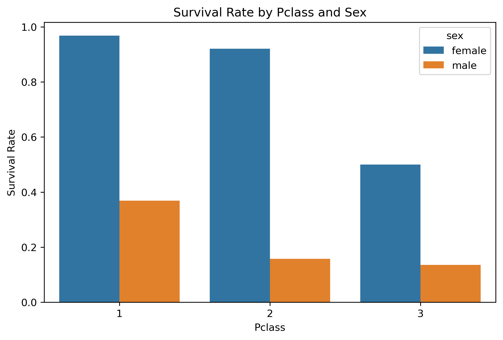

# Titanic 乘客生存率数据分析实战 (SQL + Python)

## 📖 项目背景
本项目是个人数据科学转码学习中的第一个完整实战项目。核心目标是熟悉并打通 **“数据获取 -> 数据入库 (MySQL) -> SQL 业务查询 -> Python 可视化与洞察”** 的完整数据工作流。

## 🛠️ 技术栈与工具
- **编程语言**：Python 3.13
- **数据库**：MySQL (使用 Navicat 管理)
- **核心库**：Pandas, SQLAlchemy, PyMySQL, Matplotlib, Seaborn
- **环境管理**：PyCharm, Anaconda
- **工程规范**：使用环境变量 (`.env` / 系统环境变量) 管理数据库密码，避免敏感信息泄露。

## 📊 数据来源
- **数据集**：经典 Titanic 数据集 (891 行, 15 列)
- **数据获取**：通过镜像加速下载 CSV 文件，使用 `pandas.read_csv()` 读取，并通过 `to_sql()` 写入 MySQL 数据库 `sql_practice` 中的 `titanic` 表。
- **数据字段**：包含乘客基本信息（性别、年龄、舱位、票价、登船港口）及生存标签（`survived`：0=遇难，1=生还）。

## 🔍 核心分析内容与结论

### 1. 整体生存率
- **SQL 实现**：`SELECT AVG(survived) FROM titanic;`
- **结论**：Titanic 全体乘客的总体生存率约为 **38%**，大部分乘客不幸遇难。

### 2. 性别差异对生存率的影响 (女士优先)
- **SQL 实现**：`SELECT sex, AVG(survived) FROM titanic GROUP BY sex;`
- **结论**：女性的生存率（约 **74%**）远高于男性（约 **18%**）。在灾难面前，“女士优先”的原则在数据中得到了非常直观的体现。

### 3. 多维度交叉分析 (舱位 + 性别)
- **SQL 实现**：`SELECT sex, pclass, AVG(survived) FROM titanic GROUP BY sex, pclass;`
- **结论**：
  - **头等舱女性**生存率最高（接近 **97%**）。
  - **三等舱男性**生存率极低（仅约 **13%**）。
  - 舱位等级（Pclass）和性别共同决定了生存率，体现了社会阶层在灾难中获取生存资源的能力差异。

### 4. 年龄分箱与生存率关系 (CASE WHEN 实战)
- **SQL 实现**：使用 `CASE WHEN` 将年龄分为儿童、中青年、老年，并 `GROUP BY` 统计生存率。
- **结论**：儿童（<18岁）的生存率明显高于中青年和老年群体，侧面反映了救援中“儿童优先”的原则。

### 5. 数据可视化展示 (Python)
- 使用 `pd.read_sql()` 从 MySQL 提取聚合数据，利用 `Seaborn` 绘制了不同舱位与性别组合的生存率柱状图，直观展示多维特征对生存率的影响。
- 

## 📁 项目文件说明
- `import_data.py`：负责获取 Titanic 数据并写入 MySQL 数据库（包含镜像加速下载逻辑）。
- `analyze.py`：连接 MySQL，执行 SQL 聚合查询，并使用 Matplotlib/Seaborn 进行可视化出图。
- `README.md`：项目说明文档（当前文件）。

## 🚀 后续规划
- [ ] 引入更多维度的数据清洗（处理 Age 和 Cabin 的缺失值）。
- [ ] 将 Titanic 替换为电商真实业务数据（如用户行为日志），练习计算留存率、复购率、转化漏斗。
- [ ] 结合 R 语言与统计学模型（如逻辑回归、随机森林）进行生存预测建模。

---
*Created by [yumin921] 

